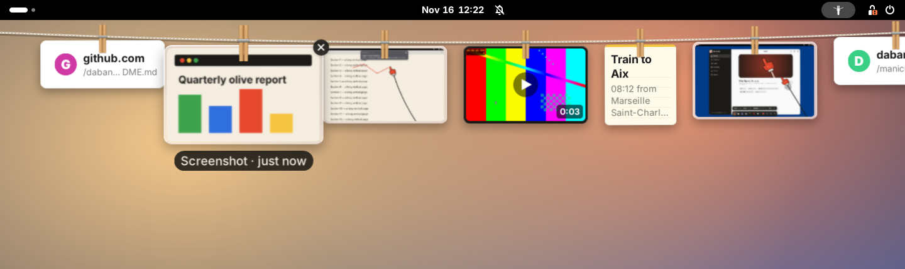
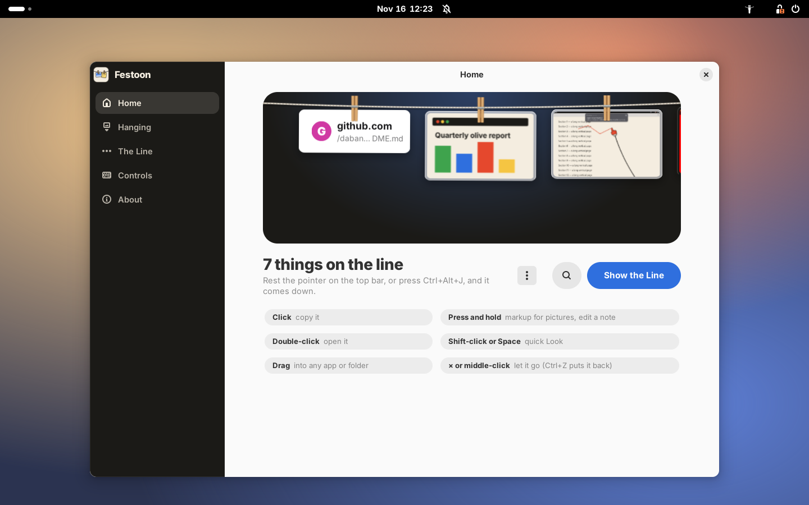

# Festoon

Your screenshots and the things you copy, hung on a line just under the GNOME top bar.



Rest the pointer on the top bar and the line slides down. Every screenshot, screen recording,
copied picture, bit of text and web address is hanging there, newest first. Click one to copy it
again, drag it into any app or folder, or let it go. A GNOME take on
[Tendedero](https://tendedero.app/) for the Mac.



**[Website with a live demo](https://dabane-ghassan.github.io/festoon/)**

## Install

```sh
curl -fsSL https://dabane-ghassan.github.io/festoon/install.sh | sh
```

Then **log out and back in once** so GNOME picks it up. After that, rest the pointer on the top
bar, click the clothespin in the top bar, or press **Ctrl+Alt+J**.

It works on any distro with the GNOME desktop, version 45 or later (Fedora 39+, Ubuntu 24.04+,
Debian 13, Arch). Nothing needs root: everything goes under `~/.local`. To remove it, run the
same line with `sh -s -- --remove` at the end.

Optional: install `tesseract` (`sudo apt install tesseract-ocr`, `sudo dnf install tesseract`)
and search also finds the words *inside* your screenshots.

## Update

```sh
festoon update
```

or press **Update Festoon** on the About page of the app. Your settings and everything on the
line are kept. Then log out and back in once more, because GNOME only loads new code at login.

## Use

| | |
|---|---|
| Rest the pointer on the top bar | The line comes down; move away and it goes back up |
| **Ctrl+Alt+J**, or click the clothespin in the top bar | Bring it down, or put it away |
| **Ctrl+Alt+F** | Search: only what matches stays; Return copies the newest match |
| Click | Copy it |
| Press and hold | Markup for a picture (pen, highlighter, arrow, box, hide); edit a note |
| Double-click | Open it in its app |
| Shift-click, or Space | Quick Look |
| Drag | Into any app (a chat, an email, a document) or into a folder |
| **×**, middle-click or Delete | Let it go; **Ctrl+Z** or *Put Back* brings it back |
| Right-click | Copy, Markup, Quick Look, Open, Show in Files, Save a Copy, Let Go |

Resting on a top-bar button (the clock, the system menu) is left to that button, but the very top
edge above it still works. The line stays out of the way of fullscreen windows, the overview and
the top bar's own menus.

### What hangs

- **Screenshots** from GNOME's screenshot tool (or anything that saves to *Pictures/Screenshots*),
  as soon as they are taken. The line comes down for a moment to show each one.
- **Screen recordings** from *Videos/Screencasts*, with their first frame and length.
- **Pictures you copy**, from a browser, an image editor or Files.
- **Text you copy** becomes a note with its first line as the title.
- **Web addresses** become a link showing the site and the path.
- **Any folder you add**: new pictures and videos saved there hang too.

Each kind can be turned off, in the app or from the clothespin's menu. Nothing is ever kept from
password managers (anything they mark as secret is skipped).

You can have new screenshots live only on the line (they move out of the Screenshots folder) and
skip GNOME's "Screenshot captured" notification. Up to 30 items stay by default; the oldest fall
off, and can be put back.

### Privacy

No account, no network, no analytics. What hangs is kept in `~/.local/share/festoon`, and the
text in screenshots is read on your computer by tesseract.

## Automation

```sh
festoon show               # hide, toggle, search
festoon hang shot.png      # hang any picture, video or text file
echo "remember the milk" | festoon hang -
festoon list               # n, kind, title
festoon copy 2             # copy the second item
festoon letgo 1            # take the newest down; putback, clear
festoon state              # JSON; items for every item
```

Links work too, for launchers: `xdg-open festoon://show` (`hide`, `toggle`, `search`,
`putback`, `clear`, `copy/<n>`).

The line answers on the session bus as `io.github.dabane_ghassan.Festoon.Line` at
`/io/github/dabane_ghassan/Festoon/Line` (methods `HangText`, `HangFile`, `Copy`, `LetGo`,
`PutBack`, `Clear`, `GetState`, `GetItems`; signal `StateChanged`).

## How it is built, and its limits

Like [Manicule](https://github.com/dabane-ghassan/manicule), Festoon is a GNOME Shell extension
plus a GTK 4 / libadwaita app. It has three parts:

- **The shell side** (`extension.js`) notices the pointer resting on the top bar and watches the
  clipboard. It also adds the clothespin to the top bar.
- **The line** (`line.js`) is a small GTK process that the shell starts at login. The shell keeps
  its window above every other window, on every workspace, and out of the overview and Alt+Tab.
  While the line is up, the window is invisible and lets every click through. It has to be a real
  app window: on Wayland, only an app can drag a file into another app.
- **The app** (`app.js`) is the window you open from your apps. It holds the settings.

Everything on the line is drawn by one widget with GTK's scene graph. A few springs move it: the
line drops and settles, items swing on their clips, slide along when one is added or let go, and
grow under the pointer.

- **Tested on GNOME 46.** The end-to-end suite in [`tests/`](tests/) passes on it (80 checks). It
  runs a real headless GNOME Shell with a real app underneath and simulated mouse and keyboard
  input. It covers clicks passing through, copying, dragging into an app, search, Markup, the
  command and restarts. Versions 45 and 47 to 51 are declared as supported but have not been run.
  The code handles the API differences it knows about, but a shell release can still break it.
- Wayland only lets the focused app set the clipboard, so copying from the line goes through the
  shell. A recording is copied as a file, not as video data.
- Drag and drop and Markup were tested with simulated input, not a physical mouse or touchpad.
  Neither of the two short sounds has been listened to.
- On an X11 session the line works, but drag and drop into apps depends on the app.

## Develop

```sh
make install    # install for your user from this checkout
make test       # end-to-end tests in a headless GNOME Shell
make assets     # redraw the logo and resynthesise the sounds from tools/
make dist       # dist/festoon.tar.gz and festoon.shell-extension.zip
```

## License

MIT. See [LICENSE](LICENSE).
